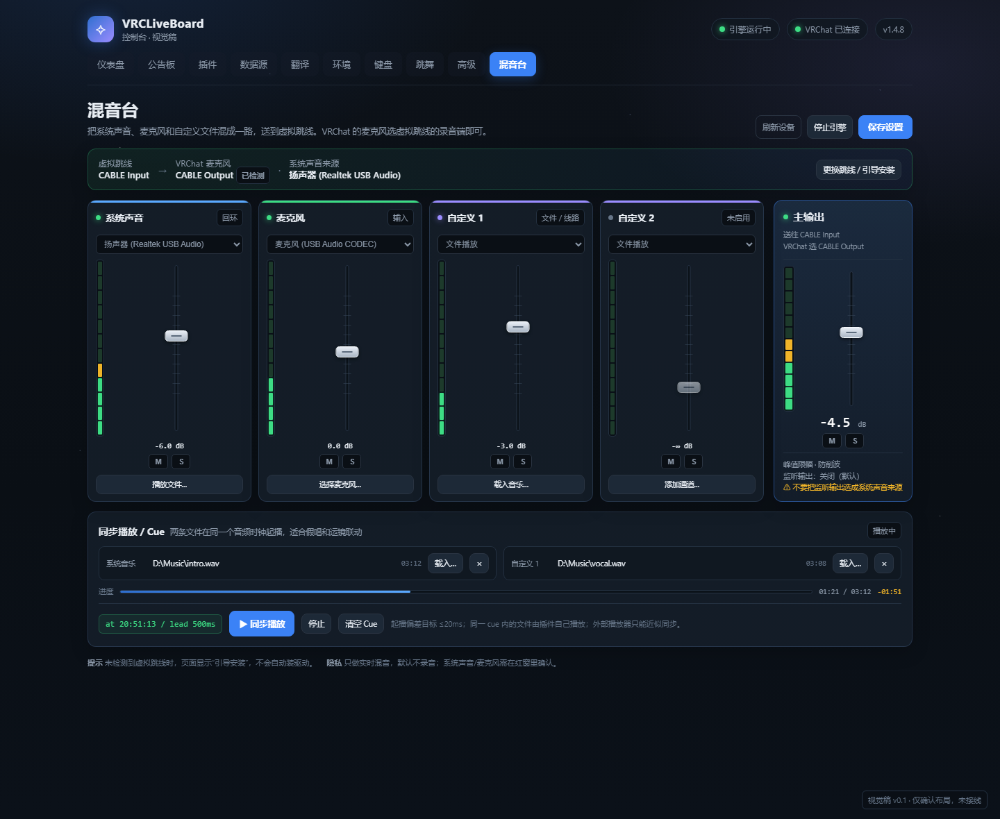
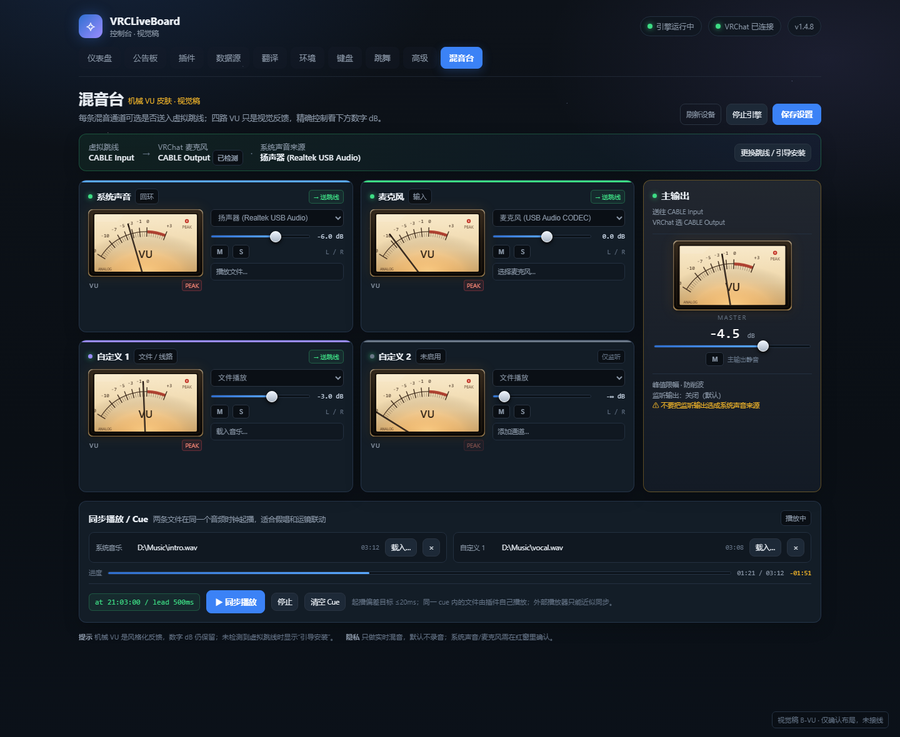

# F-20261123-01 简易虚拟混音台总线

> 状态: **方案与视觉细节已确认（D1 引导安装 / 单跳线 / B1 通道 / C1 同步 / D4 双布局 A+B-VU / E1 引擎 / F1 自动化；B-VU 默认）**。未开发。
> 流程: `docs/PROCESS-02-开发更新.md` D0/D1；本卡先回答七问和四张契约，确认后再进 D2。

## 0. 状态与归属

- 状态: **BUILD（M2.1 后端已迁主程序：引擎/manager/API；主 Tab 走主 API；下一步视觉定稿与插件退役）**
- 归属: **插件**（`plugins/virtual-mixer`）+ **主程序控制台新增混音台页面**（仅 UI/接口桥，不放核心音频算法）
- 目标版本: 插件 `0.1.0`；主程序 UI 改动按 PROCESS-02 走 milestone（不混进补丁位）
- 关联: 待实现后写 DEV-NOTES 条目。

## 0.1 需求逐条回读（防理解偏差）

| 用户原话要点 | 本方案对应 | 需要用户确认 |
| --- | --- | --- |
| 提供一个虚拟音频线路输入，作为游戏内麦克风输入 | 插件把混音结果输出到**一根虚拟音频线的播放端**；VRChat 麦克风选它的录音端 | **D1**: 接受“用户安装一根虚拟音频线（VB-CABLE 即可）”吗？ |
| 设置里三个或更多虚拟输出通道：系统 / 麦克风 / 自定义 | 3 条内部混音 strip（可扩到 8 条），每条可独立选择“是否送入虚拟跳线”；master 合并后送往 VRChat 麦克风 | **D2 已确认**: 不是三个独立 Windows 设备，而是三路可选的混音通道 |
| 麦克风通道需要降噪 | 只在 mic 通道插入降噪链；system/custom 完全旁路；VRChat 自带 NS 可关闭 | 新增需求，推荐方案见 §1.8 |
| 讲话时自动压低音乐，防止听不清 | **主需求：电台式侧链 ducking** —— mic 电平触发，把选中的系统/自定义通道平滑压低；mic 动态压缩只作辅助 | 已确认，方案见 §1.9 |
| 类似 OBS 混音台 | 控制台新增“混音台”页：推子、电平、静音、独奏、输出选择 | **D4**: 接受主程序新增页面吗？ |
| 直播时方便控制声音、假唱效果 | 系统声/麦克风/自定义文件可独立混音；cue 同步启动两轨文件 | **D3**: 两个文件由插件自己播放吗？ |
| 执行运镜时系统放音乐 A，同时插件声道放文件 B | cue：同一 `at` 时间戳内多条 action，共用音频时钟；camera-path 通过内部 API 调 `cue` | 需要确认是否允许新增 `ctx.plugins.call` 小桥 |
| 标准化自动化编程命令供二次开发 | 复用 `POST /api/plugins/call`，固定 JSON 方法/错误码 | **D6**: 是否还要 OSC 控制？ |

## 0.2 前置硬限制（必须知道）

1. **用户态程序不能创建 Windows 音频设备**。要“在 VRChat 麦克风列表里出现一个新设备”，必须安装并签名内核音频驱动，或使用现成虚拟声卡（VB-CABLE / Voicemeeter 等）。本插件只做混音和检测，**不打包/静默安装驱动**。
2. 控制台自带插件 HTML 面板在当前 1.4.x **不可用**；要做推子/电平表，需要主程序新增页面，不能只靠插件。
3. 与外部 OS 播放器的“逐样本同步”做不到；要精确同步，必须由插件自己播放两条文件。
4. **“VB-CABLE”本身就是一根虚拟跳线**：安装后得到一对端点（播放端 `CABLE Input` + 录音端 `CABLE Output`）。**不需要装完整 Voicemeeter，也不需要三条线**；三条混音通道在插件内部混合后，走同一根线即可。


## 0.3 虚拟跳线的安装方式（需拍板）

“给装个 VB 的虚拟跳线”可以分成三种做法，插件功能和音频链路都一样，区别在**谁负责装驱动**：

| 方式 | 做法 | 评价 |
| --- | --- | --- |
| **A 用户安装一次（推荐）** | 用户从 VB-Audio 官方下载安装 VB-CABLE；插件自动检测 `CABLE Input/Output`，配置向导指路 | 最简单、许可与 UAC 风险最低；本机已装其它虚拟设备可直接用 |
| **B 插件引导安装** | 插件提供“下载/打开官方安装器”按钮，用户手动点 UAC；插件不复制驱动文件 | 体验比 A 好；需要核实官方安装器分发许可与联网下载策略 |
| **C 打包/静默安装** | 把驱动安装包放进发布包或插件自动安装 | **默认不做**：涉及驱动分发许可、管理员权限、杀软误报、安装失败回滚；需单独立项和安全评审 |

无论 A/B/C，**都只需要一根虚拟跳线**；三条内部混音通道共用它。

## 0.4 测试环境准备（2026-11-23）

- 已用官方安装程序卸载 **Voicemeeter**：卸载注册表项与 `Voicemeeter*` 音频端点已消失；程序目录只剩 `voicemeetersetup.exe`。
- 驱动包 `oem70.inf`（`vbvoicemeetervaio64_win10.inf`）仍在 DriverStore；按官方 readme，**必须重启 Windows 后**才算彻底移除。
- 本机仍有 `Virtual Desktop Audio`、`网易虚拟音频设备`、Steam Streaming 等其它虚拟设备；它们不是 VB-CABLE/Voicemeeter，模拟“没有 VB 混音器”的用户时保留即可，但会在设备列表中显示。
- 重启后应复查：`Voicemeeter` 端点不存在；默认播放/录音设备切回物理耳机/麦克风。
## 1. 七问(D0)

### 1.1 谁在什么场景下用

VRChat 主播/整活用户：希望把「系统正在播放的声音」「自己的麦克风」「自定义文件/线路」分别控制后，混成一路送给 VRChat 的麦克风输入；直播时能单独静音/推子调节，并做“一边放原曲、一边放另一段人声/音效”的假唱式演出。

### 1.2 要不要占聊天框

**不占**。本功能只处理音频，不向 VRChat 聊天框发送文本；也不注册数据源。

### 1.3 新配置项（建议，待确认）

| key | 默认 | 说明 |
| --- | --- | --- |
| （插件启用状态） | 关闭 | 由插件管理器控制，不是 `config` 键；新功能默认不启用 |
| `.autoStart` | false | 启用插件后是否自动启动音频引擎 |
| `.masterOutputDevice` | 空 | 虚拟声卡“录音端”对应的播放设备（如 CABLE Input / Voicemeeter Input） |
| `.virtualMicCaptureDevice` | 空 | VRChat 麦克风要选的录音设备（如 CABLE Output），仅用于检测/指引 |
| `.monitorOutputDevice` | 空 | 本地监听输出（建议默认关闭，防回授） |
| `.systemCaptureDevice` | 默认播放设备 | 系统声音回环捕获的播放端 |
| `.micCaptureDevice` | 默认录音设备 | 物理麦克风输入 |
| `.channels.mic.denoise` | `off` | 麦克风专用降噪挡位: off / light / standard / strong（只作用于 mic 通道） |
| `.channels.mic.highPassHz` | 80 | 麦克风高通滤波截止频率；降低桌面震动/喷麦低频 |
| `.channels.mic.compressor` | `off` | 麦克风动态压缩挡位: off / light / standard |
| `.ducking.enabled` | false | 讲话时自动压低指定通道 |
| `.ducking.targets` | `["system","custom-1"]` | 闪避目标；**不包含 mic**，默认压音乐/自定义 |
| `.ducking.depthDb` | -15 | 闪避深度（负值，越大越明显） |
| `.ducking.thresholdDb` | -35 | mic 侧链触发阈值 |
| `.ducking.attackMs` | 30 | 起压时间（短=反应快） |
| `.ducking.releaseMs` | 400 | 释放时间（长=不抽吸） |
| `.ducking.holdMs` | 500 | 讲话停顿保持，避免尾音刚出就回升 |
| `.ducking.lookaheadMs` | 8 | 起音前视，避免字头被漏掉 |
| `.ducking.sidechainHpfHz` | 120 | 侧链高通，避免低频误触发 |
| `.channels` | 3 条 | `system` / `mic` / `custom-1`，可加 `custom-2..8` |
| `.channels[].gainDb` | 0/-6 等 | 每条通道增益 |
| `.channels[].muted` | false | 静音 |
| `.channels[].solo` | false | 独奏 |
| `.latencyTargetMs` | 80 | 目标端到端延迟（后续按实测调整） |
| `.musicDir` | 空 | 允许播放的音频目录（安全边界） |
| `.enginePath` | 插件内置 | C# 音频引擎路径（默认插件 `engine/VirtualMixer.exe`） |

公开版默认关闭；涉及麦克风/系统声音采集，首次启用必须在红窗里单独确认“音频采集 + 进程执行”两项。

### 1.4 新端点

**不新增全局端点**，复用现有插件调用契约：

`POST /api/plugins/call`

请求 `{ "id": "virtual-mixer", "method": "<方法>", "args": { ... } }`；由插件 `api` 暴露标准方法；仅本机控制台/本机自动化程序可用。

若确实需要“混音台”实时页面，新增只读/控制型主程序页面（见 1.7 与开放决策 D4），页面只调用上述插件方法，不直接碰音频设备。

### 1.5 新依赖

- **音频引擎（推荐）**: C#/.NET Framework 4.8 小型 helper，使用 **NAudio**（MIT 许可，需 vendor DLL + THIRD-PARTY 声明）；负责 WASAPI 回环/麦克风采集、文件解码、混音、输出。
- **虚拟声卡驱动**: **不随包、不静默安装**。用户需已有 VB-Audio Virtual Cable / Voicemeeter / 其它虚拟音频设备；插件只做设备检测、选择和 VRChat 设置指引。
- 体积预估: helper + NAudio 约 2–6MB（待实测）；无 Python/ffmpeg 运行时依赖。

### 1.6 失败降级

- 找不到虚拟声卡：插件显示 `NO_VIRTUAL_CABLE` + 安装指引，不启动引擎；VRChat 设置保持不变。
- 引擎启动失败/崩溃：插件进入 `engine-error`，停止所有音频，释放进程，控制台提示日志位置；不阻塞主程序。
- 采集设备被拔出/切换：该通道静音并在状态中标红；其它通道继续；可一键重连。
- 文件不可读/格式不支持：只拒绝该次 `load`，不影响当前混音。
- 主程序退出/插件停用：引擎必须收到 shutdown；超时强制结束；不留后台进程。

### 1.7 不做什么（非目标）

- 不开发/打包/签名 Windows 内核音频驱动；不承诺“装上插件就有新声卡”。
- 不做 DAW：不做多轨编辑、效果器链、自动修音、变声、录音导出。
- 不控制任意第三方播放器；不承诺与 OS 播放器逐样本同步。
- 不开远程网络控制；控制只在本机回环。
- 不做 OBS 替代品；只做“送给 VRChat 麦克风的一路混音 + 可编程控制”。

### 1.8 麦克风通道降噪（2026-11-24 新增，推荐）

**为什么需要**：VRChat 的 NS 是全局的。放音乐时通常要关掉，否则音乐会被当噪声；但弹唱时麦克风又需要降噪。插件在 mic 通道单独插入降噪，就能同时满足：系统/自定义通道保持原样，麦克风按场景开关。

**原则**：

- **只作用于 mic 通道**；system / custom 文件/线路完全旁路，不做任何降噪或门限。
- 不修改 VRChat 的 NS 设置；文档提示：用插件的 NS 时建议把 VRChat NS 关掉，避免双重处理。
- 默认关闭；需要时在麦克风卡里选挡位，可随时 A/B 切换。

**挡位建议**：

| 挡位 | 处理 | 适用 |
| --- | --- | --- |
| `off` | 完全旁路 | 纯音乐/不希望改变音色 |
| `light` | 80Hz 高通 + 温和扩展器/门限 | 弹唱：保留尾音，压掉桌面低频与底噪 |
| `standard` | RNNoise 语音降噪 + 高通 | 说话/直播：稳态噪声抑制 |
| `strong` | RNNoise + 更紧的门限 | 风扇/空调等嘈杂环境 |

**实现建议**：

- `light` 用 NAudio/自研 managed 高通 + 软门限，零额外原生依赖，适合唱歌。
- `standard/strong` 优先 **RNNoise**（BSD-3，48kHz mono，约 10ms 延迟）；作为随插件的 native DLL vendor，不需要用户安装第三方软件；`THIRD-PARTY.md` 登记。
- RNNoise 加载失败时自动退回 `light`（managed），不能因为降噪失败导致麦克风无声。
- CPU 目标：mic 一路 standard 小于 2%；off 时零处理。

**验收**：

- 说话：关/开 standard，底噪明显下降，不出现“字头被吃掉”。
- 弹唱：light 不切断长音尾音；与 VRChat NS 关闭时 A/B 无爆音/抽吸。
- 系统/自定义通道在 mic 降噪开启时输出波形不变（旁路验证）。

**API/配置**：`channel.set` 增加 `denoise`（仅 mic 有效）；`status` 回 `channels.mic.denoise`；Cue 暂不自动切换挡位（需要时可加 cue action）。

### 1.9 电台式讲话闪避 + mic 压缩（2026-11-24，主需求=闪避）

**核心场景**：电台节目/直播主持。主持人一说话，背景音乐自动变小；停顿后音乐平滑回到原音量。

这就是 **sidechain ducking（侧链闪避）**，优先级高于 mic 压缩：

- **讲话闪避**：mic 电平触发，把选中通道（默认 system + custom-1）平滑压低，让人声清楚。
- **mic 压缩**：只让麦克风自己的电平更稳，是辅助项；它**不会**主动压低音乐。

**闪避行为（默认值，可调）**：

- 目标：`system` + `custom-1`；**不包含 mic**；用户可勾选哪些通道让路。
- 深度：默认 **-15 dB**（可调 -3～-24）；电台说话时音乐明显变小，但不至于完全消失。
- 触发：mic 侧链检测约 -35 dBFS；侧链先做 120Hz 高通，避免低频音乐/桌面震动误触发。
- 时间：attack `45ms`（人声起音让路，2026-11-25 按听感放缓）、release `600ms`、hold `650ms`（停顿不马上回升，避免抽吸）。
- 平滑：8ms lookahead + 包络平滑；只做增益变化，不改变音乐音高/速度；master limiter 在闪避之后。
- mic 静音、低于阈值或被 Mute 时不触发；切换预设/停止引擎时立即复位。

**预设**：

| 预设 | mic 降噪 | mic 压缩 | 讲话闪避 | 适用 |
| --- | --- | --- | --- | --- |
| 音乐 | off | off | off | 纯放音乐/听歌 |
| **电台主持** | standard | light（可选） | **on，-15dB** | 主持说话时音乐自动让路 |
| 弹唱 | light | light | off（或仅自定义伴奏让路） | 唱歌时不要压掉伴奏 |

**mic 压缩（辅助）**：

- 只处理 mic：阈值约 -18/-24 dBFS、ratio 2:1/3:1，attack/release 轻/标准两档；不压音乐。
- 自动 makeup，但不越过 master limiter；与降噪一起用，避免把底噪抬起来。
- 链路：`HPF → 降噪 → 压缩 → 混音`；闪避检测在压缩之后、混音之前。

**API/配置**：`ducking.set` 控制闪避；`preset.apply` 支持 `music / radio / sing`；`channel.set` 的 mic `compressor` 为可选辅助；`status` 回实际参数。

**验收**：

- 电台场景：音乐播放中说话，音乐在约 100ms 内降到约 -15dB；停顿约 650ms 后平滑恢复；无“抽吸”/爆音。
- 弹唱预设关闭闪避：伴奏不被 mic 误压；压缩只让 mic 峰值更稳。
- 未被选中的通道波形不变；闪避不改变音乐速度/音高。
- 与 VRChat 自带 NS/AGC 同时开启时，文档提示优先只用一边，避免双重处理。
## 2. 四张契约(D1，建议稿)

### 2.1 API 契约（插件方法）

| 方法 | 参数 | 返回 | 说明 |
| --- | --- | --- | --- |
| `status` | 无 | `{ok, engine, channels, devices, cue}` | 页面轮询 |
| `devices` | 无 | `{render:[], capture:[]}` | 设备列表，含友好名/ID |
| `configure` | `{masterOutputDevice?, systemCaptureDevice?, micCaptureDevice?, monitorOutputDevice?}` | `{ok}` | 保存并热切换 |
| `channel.set` | `{id, gainDb?, muted?, solo?, denoise?, compressor?}` | `{ok, channel}` | 推子/静音/独奏；`denoise`/`compressor` 仅 mic 有效 |
| `master.set` | `{gainDb?, muted?}` | `{ok}` | 主输出 |
| `ducking.set` | `{enabled?, targets?, depthDb?, thresholdDb?, attackMs?, releaseMs?, holdMs?}` | `{ok, ducking}` | 讲话闪避参数 |
| `preset.apply` | `{name:"music"\|"radio"\|"sing"}` | `{ok, preset}` | 一键切换场景预设 |
| `file.load` | `{channel, path, loop?, gainDb?}` | `{ok, durationMs}` | 只允许 `musicDir` 内、音频扩展名 |
| `file.play` | `{channel}` | `{ok, startedAt}` | 立即播放 |
| `file.stop` | `{channel}` | `{ok}` | 停止并释放文件 |
| `cue` | `{at, leadMs?, actions:[...]}` | `{ok, cueId, startAt}` | **同步启动多条文件**；**整体替换**当前 cue（见 2.2） |
| `cue.remove` | `{channel}` | `{ok, actions}` | 清除某一路已载入的文件 |
| `cue.clear` | 无 | `{ok}` | 停止并清空所有待播放项（保留通道增益/设备设置） |
| `panic` | 无 | `{ok}` | 全部静音/停止 |

错误码（`error` 字符串或 `code`）: `NO_VIRTUAL_CABLE` / `NO_ENGINE` / `BAD_DEVICE` / `UNSUPPORTED_FILE` / `PATH_DENIED` / `BUSY` / `ENGINE_ERROR`。

### 2.2 同步 cue 契约

```json
{
  "id": "virtual-mixer",
  "method": "cue",
  "args": {
    "at": 1760000000000,
    "leadMs": 500,
    "actions": [
      { "channel": "system", "path": "D:/Music/intro.wav", "gainDb": -6, "loop": false },
      { "channel": "custom-1", "path": "D:/Music/vocal.wav", "gainDb": 0, "loop": false }
    ]
  }
}
```

- `at`: epoch ms；引擎在同一个音频时钟上排程多条 action，**同一 cue 内的文件起播偏差目标 ≤20ms**。
- `leadMs`: 给采集/解码预留的提前量；默认 500ms。
- **`cue` 是整体替换，不是追加**：下一次只传一条 action 时，不会继承上一次的第二条文件。
- UI 每行有 `×` 清除单路，底部有「停止」（只停）与「清空 Cue」（停止并清空所有待播放项）；空槽不会被送去播放。
- 不建议依赖外部播放器；若用户坚持“系统播放器放 A、插件放 B”，只能做**近似同步**，需在文档中明确。

### 2.3 配置契约

插件 `manifest.settings` 只放少量静态项（设备选择、音乐目录、自动启动、token）；通道推子等动态状态由页面/API 维护，落盘到 `ctx.config`，老配置缺键一律取默认值。

### 2.4 权限契约

```json
{
  "network": [],
  "filesystem": { "read": [], "write": [] },
  "process": true,
  "ports": []
}
```

注: 插件进程权限会触发红窗高危提示。插件自身不联网；音频引擎是独立进程，只读 `musicDir` 内音频、不写文件、不联网；控制通道使用本机 named pipe（若改用回环 HTTP，则只绑 127.0.0.1）。

## 3. 推荐技术方案（待确认）

### 3.1 音频引擎

- C#/.NET Framework helper（`plugins/virtual-mixer/engine/VirtualMixer.exe` + NAudio DLL），由插件启动，经本机 named pipe 受控（不把控制端口暴露到网络）；不把音频处理塞进 Node 主线程。
- 采集: `WasapiLoopbackCapture`（系统声音，选播放端）+ `WasapiCapture`（麦克风，选录音端）。
- 混音: 32-bit float、48kHz 内部格式；每通道 gain/mute/solo；主输出 peak limiter，防削波。
- 文件: WAV/MP3 起步（NAudio 解码）；FLAC/OGG 作为后续扩展（需额外组件，先不做）。
- 输出: `WasapiOut` 到虚拟声卡“播放端”；VRChat 麦克风选同一虚拟声卡的“录音端”。
- 本地监听: 可选第二输出；**默认关闭**，并检测“监听输出 == 系统采集端”时禁止开启，防回授。

### 3.2 为什么不是纯 Node/Electron

- Node 没有稳定的 WASAPI 回环采集能力；原生 addon 需要编译/ABI 匹配，不适合随包分发。
- Electron WebAudio 的 `getDisplayMedia` 需要用户每次授权，且不适合后台常驻混音。
- Python 方案需要额外便携 Python + soundcard/numpy 依赖，包体和部署复杂度更高；C# helper 更可控。

### 3.3 虚拟声卡

- **最小要求**：一对虚拟音频端点（一个播放端给程序写入，一个录音端给 VRChat 选择）。VB-CABLE 就是这种“虚拟跳线”，不需要 Voicemeeter 的完整混音器。
- 其它 WASAPI 虚拟设备（VoiceMeeter、Virtual Audio Cable 等）也可用；插件自动枚举并推荐，不打包驱动。
- 首次配置向导: 选 master 输出设备 → 选 VRChat 麦克风设备 → 测试 1kHz/语音 → 保存。
- 如果你要求“插件自己创建声卡”，那就需要开发并签名内核驱动，属于独立项目，不在本插件范围。

### 3.4 与控制台/运镜联动

- 外部自动化: 现有 `POST /api/plugins/call` 已能调用插件方法；提供标准 JSON 命令，可供 OBS 脚本、Stream Deck、Python/Node 脚本、运镜自动化程序调用。
- 内部联动: 给插件管理器增加一个小的 `ctx.plugins.call(id, method, args)` 桥（仅插件 API，不给任意代码执行）；camera-path 在运镜开始时调用 `virtual-mixer.cue`，把“音乐 A + 声道 B”排到同一 cue。
- 不建议用网络端口做插件互调；优先进程内 API。

## 4. 切片计划（确认后执行）

- [x] S1 引擎骨架 + 设备枚举 + 文件播放/混音（无采集），离线 selftest + 输出 WAV 验证。（2026-11-24 完成，12 PASS）
- [ ] S2a 系统回环 + 麦克风采集 + 通道增益/静音/独奏/limiter；mic 降噪插槽(off/light/standard/strong)；**电台讲话闪避(核心)**；异常恢复。
- [ ] S2b mic 压缩（辅助挡位）+ 预设 music/radio/sing；A/B 调参。
- [ ] S3 虚拟声卡检测/向导 + VRChat 麦克风路由 + 控制台“混音台”页面（主程序 UI 改动）。
- [ ] S3a A 通道条布局（数字表/数字推子）。
- [ ] S3b B-VU 布局（机械表 + 数字兜底）与布局切换持久化。
- [ ] S4 cue 同步 API + camera-path 联动 + 三语文档 + 插件包/市场包 + 安全审计。

每个切片独立可 revert；插件默认关闭；主程序 UI 切片不进补丁位。

### S1 完成记录（2026-11-24）

- 新增插件骨架 `plugins/virtual-mixer`（v0.1.0，experimental）：`status` / `engineVersion` / `devices` / `selftest` / `start` / `stop` 方法。
- 新增 C#/.NET Framework 引擎 `engine/VirtualMixerEngine.cs` + `NAudio.dll`：`--version` / `--list-devices` / `--selftest`；离线生成双轨 48kHz/2ch WAV 并混音，输出 peak/RMS/时长。
- 证据：`node plugins\virtual-mixer\test\engine-selftest.js` → **12 PASS / 0 FAIL**；`plugin-check` / `plugin-behavior` / `surface-scan` / `encoding-lint` 全部 PASS。
- 尚未接入：实时采集、降噪、闪避、压缩、A/B-VU 页面；S1 引擎不启动即不出声，插件默认不启用。
### S2a 核心记录（2026-11-24）

- 新增 `Ducker.cs`：mic 侧链包络、120Hz 高通、threshold -35dB、depth -15dB、8ms lookahead；2026-11-25 起默认 attack 45ms / release 600ms / hold 650ms；只压低目标通道，不压 mic。
- 引擎新增 `--duck-selftest <wav> [json]`：合成 3s 双轨，讲话段音乐衰减实测 **9.7dB**（目标 ≥6dB）；输出 WAV 为 48kHz/2ch。
- 插件新增 `duckSelftest()` 桥；版本升至 **0.2.0**；`npm run test:mixer` → **17 PASS / 0 FAIL**。
- **S2a 采集链路完成(2026-11-24)**: `--capture-test` 用 WasapiLoopbackCapture + WasapiCapture 真实采集 48k 混音写 WAV（不开扬声器）；smoke **6 PASS**；默认设备下 frames=66720/sysBytes=660480/micBytes=328320。
- 下一片：实时输出/监听、降噪/压缩、A/B-VU 页面。
### S2b 输出 smoke 记录（2026-11-24）

- 新增 `engine/OutputTest.cs`：`--output-test <seconds> [renderId] [micId] [result.json]`，采集→Ducker→`WasapiOut` 输出；用于接虚拟跳线后实测。
- 本机默认设备 1s 静音 smoke：frames 45120、sysBytes 506880、micBytes 249600、mixedPeak 0、duck gains 1；**没有可听输出**（采集源静音）。
- 当前系统没有 VB-CABLE/Voicemeeter 端点；真实“输出到虚拟跳线 → VRChat 麦克风”的实测待引导安装后做。
- 插件/引擎版本 0.4.0；采集 WAV smoke 6 PASS，离线混音/闪避 17 PASS。
### S3 引导检测记录（2026-11-24）

- 插件新增 `setup()`：枚举设备并匹配 `CABLE Input` / `CABLE Output`；返回 `installed`、两端设备、官方引导 URL 与 4 步安装说明。
- 2026-11-24 已安装官方 **VB-CABLE Driver Pack 46**（安装器 2.1.5.8，签名有效）；`setup()` 现在 `installed=true`，检测到 `CABLE Input` / `CABLE Output`；安装后需重启。
- 安装器把默认播放/录音切到 CABLE；已恢复为安装前的 `RTK FHD HDR` / `Virtual Desktop Audio`，避免系统声音被吞。
- 官方包已核对 Authenticode；安装走 UAC，重启后做 VRChat 实机。
### S3 CABLE 回路验证（2026-11-25）

- 重启后确认 `CABLE Input` / `CABLE Output` 端点存在，默认音频仍为物理设备。
- `npm run test:mixer:cable`：**3 PASS / 0 FAIL**（CABLE Input/Output present / captured CABLE Output / tone reached CABLE Output mixedPeak=0.162）。
- 说明: 仅向虚拟线 CABLE Input 注入 440Hz，再从 CABLE Output 采集；不打开物理扬声器。
- 待做: VRChat 麦克风选 CABLE Output，讲话+音乐实测闪避/恢复。
### S3 VRChat 链路调试记录（2026-11-25）

- 真实设备: 耳机播放/麦克风为 `Front Mic (Realtek USB Audio)`; 磁带音乐在 `麦克风 (USB Audio CODEC )`; VRChat 麦克风已按日志切到 `CABLE Output (VB-Audio Virtual Cable)`。
- 发现并修复: 旧 `--output-test` 把同一个 `CABLE Input` 同时用于采集回环和输出, 形成自反馈/削波; 现已拆成 **captureRender** 与 **outputRender** 两个参数, 输出到 CABLE 时采集物理 RTK 输出。
- 当前混音: 磁带自定义 0.45、耳机麦 +6dB、软/硬限幅; 20s 无语音 smoke peak 0.237, 无削波。
- 用户实机反馈: 电平表有反应, 链路已通; 初次“麦克风被压低/闪避不自然”已定位为自反馈+相对电平, 麦 +6dB/音乐降低后待复测。
- 下一轮: 按听感调 threshold/depth/attack/release/hold; 做 A/B-VU 页面与实时启停 API。
### S3 实机音色确认（2026-11-25）

- 真实路由：耳机麦 `Front Mic (Realtek USB Audio)` → 侧链；磁带 `麦克风 (USB Audio CODEC )` → 自定义音乐通道；输出 `CABLE Input`；VRChat 麦克风 `CABLE Output`。
- 关键修复：输出测试拆成 **captureRender** 与 **outputRender**，不再把 CABLE Input 同时回环采集，消除自反馈/削波。
- 用户试听后确认：麦克风 +4dB、磁带 custom 0.72、attack 45ms / release 600ms / hold 650ms 这组可以定。
- 60s 实机：duckMinGain 0.1778（-15dB）、duckMax 1、mixedPeak 0.437，无削波；VRChat 电平表有反应。
### S3 实时启停与手动参数（2026-11-25）

- 新增 `LiveEngine.cs` + `--run <config.json>`：持续采集系统/麦克风/自定义输入 → Ducker → CABLE Input，直到插件停止。
- 插件新增 `start()` / `stop()` / `liveConfig()` / `reloadConfig()`；`autoStart` 保存后自动启停。
- `manifest.settings` 增加 14 个可调项：设备 4 项 + 麦克风/音乐/系统增益 + 闪避开关/深度/阈值/attack/release/hold/lookahead/HPF；默认值即用户确认值（麦+4dB、音乐0.72、45/600/650）。
- 安全：默认 autoStart=false；设备名精确匹配，找不到拒绝启动；数值在插件侧夹取范围，避免误输出/极端参数。
- 验证：`test:mixer` **21 PASS**；插件 start→running→stop 实测通过；全量门禁 **16 PASS / 0 FAIL**。
### S3 A/B 混合台卡片（2026-11-25）

- 在插件卡片内新增“虚拟混音台”自定义 UI：A/B 布局可切换；A=通道条+数字 dB，B=机械 VU（主输出单只大表）+ 峰值灯+数字 dB。
- 设备下拉：主输出/系统采集/麦克风/自定义输入；增益滑杆：麦克风/音乐/系统；高级参数：深度/阈值/attack/release/hold/lookahead/HPF。
- 开始/停止按钮走插件 `start/stop`；保存参数后重启引擎；电平/闪避状态来自 `meter()`（LiveEngine 每秒写 status）。
- 修复实时引擎：采集缓冲改为非阻塞读取；状态改为按循环计数刷新，避免 `ReadFully` 卡死导致 UI 电平一直 0。
- 节点：三语键已补（zh-CN/zh-TW/en）；前端语法/控件/启动门禁 PASS；全量门禁 **16 PASS / 0 FAIL**。
- 性能修复(用户反馈“特别卡”): 状态文件写移出音频线程(后台 Timer 500ms)，`meter` 改异步读，UI 500ms/只更新本卡片引用/不可见降频。
- 延迟修复(用户反馈“说话 3 秒后电平才动”): 循环按目标时钟补偿处理耗时，启动清空预热缓冲，输出缓冲 200ms，WASAPI 延迟 30ms，音频线程 AboveNormal；系统采集新增“不使用”。待用户复测。
### 正式版优化目标（2026-11-25 用户确认）

- **输出端到端 <100ms**（正式版目标；先测引擎→CABLE，再测 VRChat 端到端）。
- **VU 接近实时**：遥测不再走 500ms 状态文件，UI 目标 30fps（必要时 60fps）。
- **麦克风低电平省算力**：RMS 迟滞门限/向下扩展；低电平旁路 RNNoise；侧链检测用原始 mic，避免切辅音/VRChat 双降噪。
- **实施顺序**：低延迟音频原型 + `--latency-test` → 60Hz 遥测 + UI 弹道 → 麦克风门限/降噪旁路 → cue/运镜/视觉。
- 风险：VRChat / Virtual Desktop 自身链路可能占 50–100ms，需实测后定义可验收的游戏内上限。
### 低延迟原型 + 延迟测量（2026-11-28）

- 新增 `--latency-test`：向 CABLE Input 注入 1kHz，CABLE Output 采集，测量引擎→CABLE 往返。
- 基线/优化: 旧 Wasapi 共享缓冲测得约 190ms; 改用事件驱动 `WasapiCapture(..., true, 5)` + `WasapiOut(..., true, 5)` 后约 **100–125ms**（5 次中 99.9–126.3），仍高于正式版 <100ms 目标。
- LiveEngine 的 mic/custom 采集和输出改为 WASAPI 事件驱动 10ms 缓冲（失败回退默认）；`npm run test:mixer:latency` 可回归。
- 注意: VRChat/VD 自身语音链路还需单独测。VU 已提升到 30fps(状态 33ms/前端 33ms); CABLE 往返 ~112–126ms, 1ms 探针无改善, 当前接近 VB-CABLE/Windows 共享模式地板。
- 用途差异: 弹唱更重伴奏/cue 同步; 唱歌更重低延迟监听/返送。下一步先做 cue 同步播放, 再评估本地监听。
### 同步 Cue 播放（2026-11-28）

- 新增 `CueEngine.cs` + `--cue`：多个 WAV/MP3/AIFF 文件在同一条 48kHz 输出时钟起播，leadMs 预卷。
- 插件新增 `cue` / `cueStop` / `cueClear` / `cueStatus`；`cue` 整体替换上一组，空 files 拒绝，stop 只停，clear 停止并清空。
- 证据: `npm run test:mixer:cue` → **3 PASS**；两条 440/880Hz 文件同时起播，onset 偏差 **0ms**（目标 ≤20ms）；`cue-selftest` 时长/峰值正确。
- 已补(2026-11-28): A/B 卡片 Cue 两行(单行 ×/清空/同步起播/停止/清空) + 进度条; cueStatus progress 实测 12%→54%。
- 已补(2026-11-28): Cue 区“联动运镜”下拉; camera-path v0.4.1 新增 `playNow`; 流程 importPreset(noPlay) → cue → lead 后 playNow(近似同步, 非同一时钟)。
- Cue 增强(2026-11-28): **FLAC 支持**(Windows Media Foundation) + **Cue 峰值 dB 电平表**(200ms 区间峰值); 实测 FLAC cue-selftest 2420ms、level 0.352(-9.1dB)。
- M1(2026-11-28): Cue **麦克风回避**开关(默认关, 复用闪避参数) + 智能路径(去 Windows 复制地址引号/file:///); `test:mixer:cueapi` 4 PASS。
- M2.1(2026-11-28): 引擎副本 `src/audio/mixer/engine`; `MixerManager` 由主程序持有; `/api/mixer/*` 11 条路由; 主 Tab 改走主 API, 不再要求插件启用。camera 联动仍走 camera-path 插件。
- M2.2(2026-11-28): 主 Tab 页面头/路由条 + `mixer-page.js` 专用通道卡片(A/B、4 卡、Cue)已落地; headless 实测 4 卡渲染；主引擎新增 M/S。
- M2.2 修复(2026-11-28): M/S 实时(control 文件, 不重启引擎); A 通道条横向; B VU 按 TEAC 实机重画(-20/-10/-7/-5/-3/0/+3、红区、PEAK)。
- M2.3(2026-11-28): 独立监听输出选择 + 系统/麦克风/自定义/主输出监听按钮; 通道监听实时, 监听设备变更重启引擎。
- M2.4(2026-11-28): Cue 监听/音量; 麦克风 NoiseGate 降噪开关(实时 control)。
- 性能修复(2026-11-28): CueEngine 改缓冲反馈供样(220ms target), 修复 Windows Sleep 粒度导致播放变慢/卡顿; 实测 1.00~1.02x 实时。
- 压力测试(2026-11-28): Z:\曲库 192k/24bit 与 598MB FLAC, 单/双 Cue 均 1.00~1.01x; 并发 Live+双Cue 与单核 BelowNormal 低配模拟仍 0.98~1.01x(DEV-NOTES 430/431)。
- 细节(2026-11-28): Cue 运镜下拉补“不使用”, 可明确关闭联动。
- 路由(2026-11-28): 子通道“跳线”开关、主输出增益/M 静音; 监听不受送线影响。
- 待做: Cue 与 live 同回调、Cue 音量运行中调节、camera 内部化、插件退役/打包。
- 未做: cue 与 live mic 同一输出回调、文件选择器、相机/cue 精确锁相。
## 5. 验收断言（草稿，确认后补全）

- `ASSERT: 插件已加载|/api/plugins|virtual-mixer`
- `ASSERT: 未配置虚拟声卡时报错|/api/plugins/call|NO_VIRTUAL_CABLE`
- `ASSERT: 通道状态包含 system/mic/custom|/api/plugins/call|system`
- 离线 selftest: 两轨文件按 cue 混合到 WAV，起播样本偏移 ≤20ms，峰值 ≤0dBFS。
- 手工实机: VRChat 麦克风选 CABLE Output；说话/系统声/自定义文件均能从游戏内听到；拔设备不崩溃。

## 6. 需要用户拍板的开放决策

| 编号 | 问题 | 推荐 | 备选 |
| --- | --- | --- | --- |
| D1 | 虚拟声卡来源 | **A1 + B：一根虚拟跳线（VB-CABLE 即可）+ 插件引导官方安装器（用户点 UAC，不复制驱动）** | A1 仅手动安装；A2 只对接 VoiceMeeter；A3 打包/静默安装（不做） |
| D2 | “三个通道”语义 | **B1 三条混音 strip，每条可选“送虚拟跳线”，合并到一路 master→虚拟麦克风** | B2 三个独立 Windows 输出设备（需三条虚拟线） |
| D3 | 同步播放 | **C1 插件自己播放两个文件，同一 cue 精确起播** | C2 控制外部播放器（只能近似） |
| D4 | 界面深度 | **A 通道条 + B-VU 机械表两套布局都做，可切换（用户已确认）** | D2 只用 manifest.settings 文本字段（无实时推子） |
| D5 | 音频引擎 | **E1 C#/.NET Framework + NAudio** | E2 Python soundcard；E3 纯 Electron WebAudio |
| D6 | 自动化接口 | **F1 复用 /api/plugins/call + JSON 方法 + cue** | F2 另加 OSC 控制（可作为后续） |
| D7 | mic 降噪引擎 | **L1 light=managed 高通+软门限；standard/strong=RNNoise(BSD-3)** | L2 SpeexDSP；L3 只做 gate |

**已确认: D1-A1（引导安装）+ 单跳线、D2-B1、D3-C1、D4 双布局（A+B-VU）、D5-E1、D6-F1。**

## 7. 风险与边界

- 虚拟声卡是外部驱动：未安装/被安全软件拦截时，插件只能指路，不能替用户装。
- 系统回环采集对 DRM/受保护音频可能静音或无数据，这是 Windows 限制。
- “假唱”若要求与外部播放器逐样本同步，做不到；必须由插件自己播放两条文件。
- Windows 音频设备切换/独占模式/采样率不一致会导致断流；需要设备重连与清晰状态。
- C# helper 是二进制组件：需 code-sign/杀软误报评估、第三方许可登记、后续更新体积增加。
- 降噪可能对唱歌长音/乐器有抽吸或削弱；必须提供 light/off 并做 A/B；RNNoise 是语音模型，不保证适合所有音色。
- VRChat 与插件同时开 NS 会双重处理；文档要求用插件 NS 时关闭 VRChat NS。
- 控制台插件自带面板当前不可用；OBS 式推子界面需要主程序新增页面，不能只靠插件。

## 9. 混音台页面视觉稿

视觉稿为静态 HTML/CSS 渲染，**没有接线**；用于先确认布局、密度和信息层级。

### A. 通道条式（OBS 风格，推荐）



- 4 条通道条并排：系统声音 / 麦克风 / 自定义 1 / 自定义 2；右侧固定主输出。
- 每条通道：来源下拉、电平表、竖向推子、dB 读数、M/S、文件/设备按钮；每路可独立选择“送跳线/仅监听”；**mic 通道额外显示降噪/压缩挡位**，master 显示讲话闪避状态。
- 顶部一条“虚拟跳线 CABLE Input → VRChat CABLE Output”路由条，一眼确认链路。
- 底部同步播放/Cue：两行文件（每行可 `×` 清除）+ `at / lead 500ms` + 同步播放/停止/清空 Cue + 进度/倒计时。

### B. 卡片式（与现有控制台更一致）


- 通道改为 2×2 卡片，每条用横向推子 + 电平表；主输出单独一列。
- 更适合通道多、需要看设备/文件信息的场景；单屏可容纳 4–6 条。

### B-VU. 机械指针表变体（在 B 卡片式上增加 TASCAM 风格 VU）



- 四条通道卡片各放一只**模拟 VU 表**，主输出只放 **一只 VU**（用户确认不需要 L/R 双表）；保留数字 dB 读数、峰值 LED 和横向推子。
- **精修方向（按你给的近景参考）**：奶油色表纸、黑色刻度/数字、`+` 区红色刻度、红色 PEAK 灯、底部灯泡暖光、深色金属边框、细黑指针；刻度铺满表盘，**指针旋转中心位于可见表盘下方（被下边框遮住）**，指针从下边缘穿入表盘；只借风格，不使用 TASCAM/TEAC 商标或型号字样。
- 指针长度、支点、刻度密度、PEAK 灯位置按近景图重画；近看像机械表，缩到卡片尺寸仍能读。
- Cue 区已加 **进度条、当前/总时长、倒计时**；每行有 `×` 清除单路，底部有「清空 Cue」；数字 dB/峰值 LED 保留作精确读数。
- 机械表只做**风格化平均值**反馈；精确音量仍看数字 dB，表针不承担精确计量。
- 实现方式：SVG/CSS 指针 + 30fps 动画；VU 弹道采用约 300ms 积分/回落，指针不抖动；4–8 只表的 CPU 开销可忽略，不需要改音频引擎。
- 可选：右下角“机械表 / 数字表”切换，或只把 VU 作为主题皮肤；避免小屏看不清时无法读数。
### B-VU 的性能约束（实现前定死）

- 6–10 只表，目标 **30fps**；指针只改 `transform: rotate()`，不触发布局；表盘/刻度/背光全部静态 SVG/CSS，不逐帧重绘。
- 只在“混音台”页可见且音频引擎运行时动画；切走标签页/窗口最小化/静音无信号时 `requestAnimationFrame` 暂停 → 不占 CPU。
- 不用逐帧 `filter/blur/box-shadow`、不用 `<canvas>` 整表重绘、不整页重渲染。
- 与简单电平条相比：两者都要按帧更新 DOM；机械表只多一条指针线的局部重绘，**不会产生数量级差异**。
- 桌面壳默认 `hardwareAcceleration=off`（软件渲染），所以按更保守的预算验收：混音台打开、6 只表动画时，整机 CPU 增量目标 **<1%**；超过就自动降级为数字电平条。
- 提供“机械表 / 数字表”开关，以及低配模式（15fps / 关闭背光渐变）；不做“为了好看拖慢主程序”的取舍。
### A 与 B-VU 的关系（用户已确认两个都做）

- **A：通道条式**：适合快速推子操作，接近 OBS。
- **B-VU：卡片式 + 机械表**：适合你桌面 TASCAM 的视觉气质，默认建议作为正式外观。
- 两套共用同一套引擎/API/状态；页面右上角提供“布局：通道条 / 机械表”切换，选择写入配置，下次打开保持。
- 低配/无障碍时仍可切回 A 或 B-VU 的“数字表”回退，不影响音频功能。

### 两稿共同点

- 深色星轨主题、蓝色主色、圆角卡片、顶部状态 pill 与现有控制台一致。
- “混音台”作为现有 tab 之一，不另开独立窗口。
- 明确显示虚拟跳线两端，缺失时显示“更换跳线 / 引导安装”。
- 每个通道有 M/S；主输出有峰值限幅提示；监听默认关闭并提示防回授。

### 视觉细节确认结果

- [x] 刻度铺满表盘，指针旋转中心在表盘下边缘之外（被边框遮住）。
- [x] 主输出只用一只 VU，不做 L/R 双表。
- [x] 保留数字 dB 读数与峰值 LED。
- [x] Cue 区增加倒计时与进度条。
- [x] A 通道条 + B-VU 机械表两套布局都做，页面右上角切换。

**默认值建议（未反对即按此实现）**：默认布局 B-VU；默认显示 3 条通道（第 4 条作为“添加通道”）；主输出一只 VU。
## 8. 确认方式

用户回复以下任一形式即可进入 D1 细化/实现：

- “按推荐组合 A1+B1+C1+D1+E1+F1”；或
- 指出要改的编号（例如“通道要三个独立虚拟输出设备”“只做 VoiceMeeter”）。
