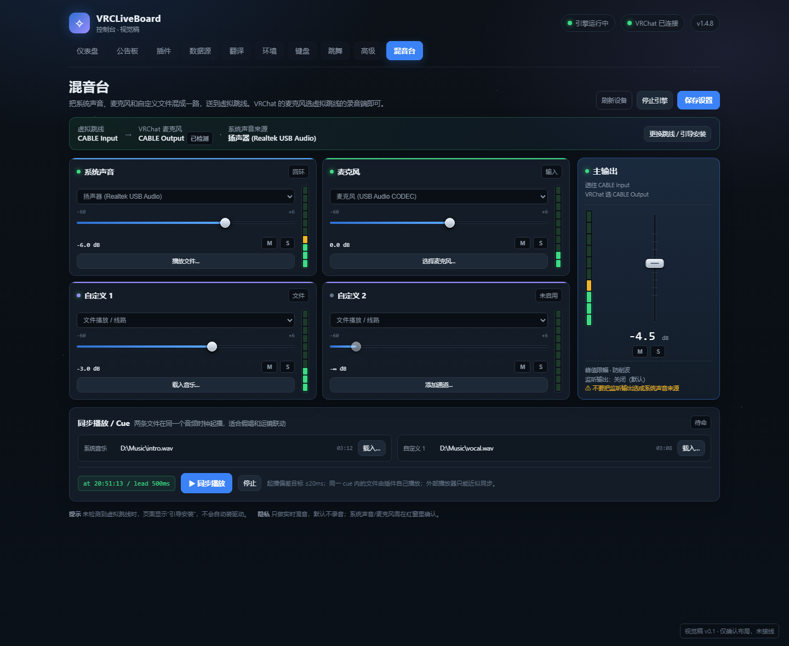

# F-20261123-01 简易虚拟混音台总线

> 状态: **方案已确认（D1 引导安装 / 单跳线 / B1 通道 / C1 同步 / E1 引擎 / F1 自动化）；D4 视觉稿等待用户在 A/B 中确认**。未开发。
> 流程: `docs/PROCESS-02-开发更新.md` D0/D1；本卡先回答七问和四张契约，确认后再进 D2。

## 0. 状态与归属

- 状态: DRAFT（方案已确认，视觉待选）
- 归属: **插件**（`plugins/virtual-mixer`）+ **主程序控制台新增混音台页面**（仅 UI/接口桥，不放核心音频算法）
- 目标版本: 插件 `0.1.0`；主程序 UI 改动按 PROCESS-02 走 milestone（不混进补丁位）
- 关联: 待实现后写 DEV-NOTES 条目。

## 0.1 需求逐条回读（防理解偏差）

| 用户原话要点 | 本方案对应 | 需要用户确认 |
| --- | --- | --- |
| 提供一个虚拟音频线路输入，作为游戏内麦克风输入 | 插件把混音结果输出到**一根虚拟音频线的播放端**；VRChat 麦克风选它的录音端 | **D1**: 接受“用户安装一根虚拟音频线（VB-CABLE 即可）”吗？ |
| 设置里三个或更多虚拟输出通道：系统 / 麦克风 / 自定义 | 3 条内部混音 strip（可扩到 8 条），每条可独立选择“是否送入虚拟跳线”；master 合并后送往 VRChat 麦克风 | **D2 已确认**: 不是三个独立 Windows 设备，而是三路可选的混音通道 |
| 类似 OBS 混音台 | 控制台新增“混音台”页：推子、电平、静音、独奏、输出选择 | **D4**: 接受主程序新增页面吗？ |
| 直播时方便控制声音、假唱效果 | 系统声/麦克风/自定义文件可独立混音；cue 同步启动两轨文件 | **D3**: 两个文件由插件自己播放吗？ |
| 执行运镜时系统放音乐 A，同时插件声道放文件 B | cue：同一 `at` 时间戳内多条 action，共用音频时钟；camera-path 通过内部 API 调 `cue` | 需要确认是否允许新增 `ctx.plugins.call` 小桥 |
| 标准化自动化编程命令供二次开发 | 复用 `POST /api/plugins/call`，固定 JSON 方法/错误码 | **D6**: 是否还要 OSC 控制？ |

## 0.2 前置硬限制（必须知道）

1. **用户态程序不能创建 Windows 音频设备**。要“在 VRChat 麦克风列表里出现一个新设备”，必须安装并签名内核音频驱动，或使用现成虚拟声卡（VB-CABLE / Voicemeeter 等）。本插件只做混音和检测，**不打包/静默安装驱动**。
2. 控制台自带插件 HTML 面板在当前 1.4.x **不可用**；要做推子/电平表，需要主程序新增页面，不能只靠插件。
3. 与外部 OS 播放器的“逐样本同步”做不到；要精确同步，必须由插件自己播放两条文件。
4. **“VB-CABLE”本身就是一根虚拟跳线**：安装后得到一对端点（播放端 `CABLE Input` + 录音端 `CABLE Output`）。**不需要装完整 Voicemeeter，也不需要三条线**；三条混音通道在插件内部混合后，走同一根线即可。


## 0.3 虚拟跳线的安装方式（需拍板）

“给装个 VB 的虚拟跳线”可以分成三种做法，插件功能和音频链路都一样，区别在**谁负责装驱动**：

| 方式 | 做法 | 评价 |
| --- | --- | --- |
| **A 用户安装一次（推荐）** | 用户从 VB-Audio 官方下载安装 VB-CABLE；插件自动检测 `CABLE Input/Output`，配置向导指路 | 最简单、许可与 UAC 风险最低；本机已装其它虚拟设备可直接用 |
| **B 插件引导安装** | 插件提供“下载/打开官方安装器”按钮，用户手动点 UAC；插件不复制驱动文件 | 体验比 A 好；需要核实官方安装器分发许可与联网下载策略 |
| **C 打包/静默安装** | 把驱动安装包放进发布包或插件自动安装 | **默认不做**：涉及驱动分发许可、管理员权限、杀软误报、安装失败回滚；需单独立项和安全评审 |

无论 A/B/C，**都只需要一根虚拟跳线**；三条内部混音通道共用它。

## 1. 七问(D0)

### 1.1 谁在什么场景下用

VRChat 主播/整活用户：希望把「系统正在播放的声音」「自己的麦克风」「自定义文件/线路」分别控制后，混成一路送给 VRChat 的麦克风输入；直播时能单独静音/推子调节，并做“一边放原曲、一边放另一段人声/音效”的假唱式演出。

### 1.2 要不要占聊天框

**不占**。本功能只处理音频，不向 VRChat 聊天框发送文本；也不注册数据源。

### 1.3 新配置项（建议，待确认）

| key | 默认 | 说明 |
| --- | --- | --- |
| （插件启用状态） | 关闭 | 由插件管理器控制，不是 `config` 键；新功能默认不启用 |
| `.autoStart` | false | 启用插件后是否自动启动音频引擎 |
| `.masterOutputDevice` | 空 | 虚拟声卡“录音端”对应的播放设备（如 CABLE Input / Voicemeeter Input） |
| `.virtualMicCaptureDevice` | 空 | VRChat 麦克风要选的录音设备（如 CABLE Output），仅用于检测/指引 |
| `.monitorOutputDevice` | 空 | 本地监听输出（建议默认关闭，防回授） |
| `.systemCaptureDevice` | 默认播放设备 | 系统声音回环捕获的播放端 |
| `.micCaptureDevice` | 默认录音设备 | 物理麦克风输入 |
| `.channels` | 3 条 | `system` / `mic` / `custom-1`，可加 `custom-2..8` |
| `.channels[].gainDb` | 0/-6 等 | 每条通道增益 |
| `.channels[].muted` | false | 静音 |
| `.channels[].solo` | false | 独奏 |
| `.latencyTargetMs` | 80 | 目标端到端延迟（后续按实测调整） |
| `.musicDir` | 空 | 允许播放的音频目录（安全边界） |
| `.enginePath` | 插件内置 | C# 音频引擎路径（默认插件 `engine/VirtualMixer.exe`） |

公开版默认关闭；涉及麦克风/系统声音采集，首次启用必须在红窗里单独确认“音频采集 + 进程执行”两项。

### 1.4 新端点

**不新增全局端点**，复用现有插件调用契约：

`POST /api/plugins/call`

请求 `{ "id": "virtual-mixer", "method": "<方法>", "args": { ... } }`；由插件 `api` 暴露标准方法；仅本机控制台/本机自动化程序可用。

若确实需要“混音台”实时页面，新增只读/控制型主程序页面（见 1.7 与开放决策 D4），页面只调用上述插件方法，不直接碰音频设备。

### 1.5 新依赖

- **音频引擎（推荐）**: C#/.NET Framework 4.8 小型 helper，使用 **NAudio**（MIT 许可，需 vendor DLL + THIRD-PARTY 声明）；负责 WASAPI 回环/麦克风采集、文件解码、混音、输出。
- **虚拟声卡驱动**: **不随包、不静默安装**。用户需已有 VB-Audio Virtual Cable / Voicemeeter / 其它虚拟音频设备；插件只做设备检测、选择和 VRChat 设置指引。
- 体积预估: helper + NAudio 约 2–6MB（待实测）；无 Python/ffmpeg 运行时依赖。

### 1.6 失败降级

- 找不到虚拟声卡：插件显示 `NO_VIRTUAL_CABLE` + 安装指引，不启动引擎；VRChat 设置保持不变。
- 引擎启动失败/崩溃：插件进入 `engine-error`，停止所有音频，释放进程，控制台提示日志位置；不阻塞主程序。
- 采集设备被拔出/切换：该通道静音并在状态中标红；其它通道继续；可一键重连。
- 文件不可读/格式不支持：只拒绝该次 `load`，不影响当前混音。
- 主程序退出/插件停用：引擎必须收到 shutdown；超时强制结束；不留后台进程。

### 1.7 不做什么（非目标）

- 不开发/打包/签名 Windows 内核音频驱动；不承诺“装上插件就有新声卡”。
- 不做 DAW：不做多轨编辑、效果器链、自动修音、变声、录音导出。
- 不控制任意第三方播放器；不承诺与 OS 播放器逐样本同步。
- 不开远程网络控制；控制只在本机回环。
- 不做 OBS 替代品；只做“送给 VRChat 麦克风的一路混音 + 可编程控制”。

## 2. 四张契约(D1，建议稿)

### 2.1 API 契约（插件方法）

| 方法 | 参数 | 返回 | 说明 |
| --- | --- | --- | --- |
| `status` | 无 | `{ok, engine, channels, devices, cue}` | 页面轮询 |
| `devices` | 无 | `{render:[], capture:[]}` | 设备列表，含友好名/ID |
| `configure` | `{masterOutputDevice?, systemCaptureDevice?, micCaptureDevice?, monitorOutputDevice?}` | `{ok}` | 保存并热切换 |
| `channel.set` | `{id, gainDb?, muted?, solo?}` | `{ok, channel}` | 推子/静音/独奏 |
| `master.set` | `{gainDb?, muted?}` | `{ok}` | 主输出 |
| `file.load` | `{channel, path, loop?, gainDb?}` | `{ok, durationMs}` | 只允许 `musicDir` 内、音频扩展名 |
| `file.play` | `{channel}` | `{ok, startedAt}` | 立即播放 |
| `file.stop` | `{channel}` | `{ok}` | 停止并释放文件 |
| `cue` | `{at, leadMs?, actions:[...]}` | `{ok, cueId, startAt}` | **同步启动多条文件**（见 2.2） |
| `panic` | 无 | `{ok}` | 全部静音/停止 |

错误码（`error` 字符串或 `code`）: `NO_VIRTUAL_CABLE` / `NO_ENGINE` / `BAD_DEVICE` / `UNSUPPORTED_FILE` / `PATH_DENIED` / `BUSY` / `ENGINE_ERROR`。

### 2.2 同步 cue 契约

```json
{
  "id": "virtual-mixer",
  "method": "cue",
  "args": {
    "at": 1760000000000,
    "leadMs": 500,
    "actions": [
      { "channel": "system", "path": "D:/Music/intro.wav", "gainDb": -6, "loop": false },
      { "channel": "custom-1", "path": "D:/Music/vocal.wav", "gainDb": 0, "loop": false }
    ]
  }
}
```

- `at`: epoch ms；引擎在同一个音频时钟上排程多条 action，**同一 cue 内的文件起播偏差目标 ≤20ms**。
- `leadMs`: 给采集/解码预留的提前量；默认 500ms。
- 不建议依赖外部播放器；若用户坚持“系统播放器放 A、插件放 B”，只能做**近似同步**，需在文档中明确。

### 2.3 配置契约

插件 `manifest.settings` 只放少量静态项（设备选择、音乐目录、自动启动、token）；通道推子等动态状态由页面/API 维护，落盘到 `ctx.config`，老配置缺键一律取默认值。

### 2.4 权限契约

```json
{
  "network": [],
  "filesystem": { "read": [], "write": [] },
  "process": true,
  "ports": []
}
```

注: 插件进程权限会触发红窗高危提示。插件自身不联网；音频引擎是独立进程，只读 `musicDir` 内音频、不写文件、不联网；控制通道使用本机 named pipe（若改用回环 HTTP，则只绑 127.0.0.1）。

## 3. 推荐技术方案（待确认）

### 3.1 音频引擎

- C#/.NET Framework helper（`plugins/virtual-mixer/engine/VirtualMixer.exe` + NAudio DLL），由插件启动，经本机 named pipe 受控（不把控制端口暴露到网络）；不把音频处理塞进 Node 主线程。
- 采集: `WasapiLoopbackCapture`（系统声音，选播放端）+ `WasapiCapture`（麦克风，选录音端）。
- 混音: 32-bit float、48kHz 内部格式；每通道 gain/mute/solo；主输出 peak limiter，防削波。
- 文件: WAV/MP3 起步（NAudio 解码）；FLAC/OGG 作为后续扩展（需额外组件，先不做）。
- 输出: `WasapiOut` 到虚拟声卡“播放端”；VRChat 麦克风选同一虚拟声卡的“录音端”。
- 本地监听: 可选第二输出；**默认关闭**，并检测“监听输出 == 系统采集端”时禁止开启，防回授。

### 3.2 为什么不是纯 Node/Electron

- Node 没有稳定的 WASAPI 回环采集能力；原生 addon 需要编译/ABI 匹配，不适合随包分发。
- Electron WebAudio 的 `getDisplayMedia` 需要用户每次授权，且不适合后台常驻混音。
- Python 方案需要额外便携 Python + soundcard/numpy 依赖，包体和部署复杂度更高；C# helper 更可控。

### 3.3 虚拟声卡

- **最小要求**：一对虚拟音频端点（一个播放端给程序写入，一个录音端给 VRChat 选择）。VB-CABLE 就是这种“虚拟跳线”，不需要 Voicemeeter 的完整混音器。
- 其它 WASAPI 虚拟设备（VoiceMeeter、Virtual Audio Cable 等）也可用；插件自动枚举并推荐，不打包驱动。
- 首次配置向导: 选 master 输出设备 → 选 VRChat 麦克风设备 → 测试 1kHz/语音 → 保存。
- 如果你要求“插件自己创建声卡”，那就需要开发并签名内核驱动，属于独立项目，不在本插件范围。

### 3.4 与控制台/运镜联动

- 外部自动化: 现有 `POST /api/plugins/call` 已能调用插件方法；提供标准 JSON 命令，可供 OBS 脚本、Stream Deck、Python/Node 脚本、运镜自动化程序调用。
- 内部联动: 给插件管理器增加一个小的 `ctx.plugins.call(id, method, args)` 桥（仅插件 API，不给任意代码执行）；camera-path 在运镜开始时调用 `virtual-mixer.cue`，把“音乐 A + 声道 B”排到同一 cue。
- 不建议用网络端口做插件互调；优先进程内 API。

## 4. 切片计划（确认后执行）

- [ ] S1 引擎骨架 + 设备枚举 + 文件播放/混音（无采集），离线 selftest + 输出 WAV 验证。
- [ ] S2 系统回环 + 麦克风采集 + 通道增益/静音/独奏/limiter；异常恢复。
- [ ] S3 虚拟声卡检测/向导 + VRChat 麦克风路由 + 控制台“混音台”页面（主程序 UI 改动）。
- [ ] S4 cue 同步 API + camera-path 联动 + 三语文档 + 插件包/市场包 + 安全审计。

每个切片独立可 revert；插件默认关闭；主程序 UI 切片不进补丁位。

## 5. 验收断言（草稿，确认后补全）

- `ASSERT: 插件已加载|/api/plugins|virtual-mixer`
- `ASSERT: 未配置虚拟声卡时报错|/api/plugins/call|NO_VIRTUAL_CABLE`
- `ASSERT: 通道状态包含 system/mic/custom|/api/plugins/call|system`
- 离线 selftest: 两轨文件按 cue 混合到 WAV，起播样本偏移 ≤20ms，峰值 ≤0dBFS。
- 手工实机: VRChat 麦克风选 CABLE Output；说话/系统声/自定义文件均能从游戏内听到；拔设备不崩溃。

## 6. 需要用户拍板的开放决策

| 编号 | 问题 | 推荐 | 备选 |
| --- | --- | --- | --- |
| D1 | 虚拟声卡来源 | **A1 + B：一根虚拟跳线（VB-CABLE 即可）+ 插件引导官方安装器（用户点 UAC，不复制驱动）** | A1 仅手动安装；A2 只对接 VoiceMeeter；A3 打包/静默安装（不做） |
| D2 | “三个通道”语义 | **B1 三条混音 strip，每条可选“送虚拟跳线”，合并到一路 master→虚拟麦克风** | B2 三个独立 Windows 输出设备（需三条虚拟线） |
| D3 | 同步播放 | **C1 插件自己播放两个文件，同一 cue 精确起播** | C2 控制外部播放器（只能近似） |
| D4 | 界面深度 | **D1 控制台新增“混音台”页面（推子/电平/静音/独奏）；视觉 A/B 待选** | D2 只用 manifest.settings 文本字段（无实时推子） |
| D5 | 音频引擎 | **E1 C#/.NET Framework + NAudio** | E2 Python soundcard；E3 纯 Electron WebAudio |
| D6 | 自动化接口 | **F1 复用 /api/plugins/call + JSON 方法 + cue** | F2 另加 OSC 控制（可作为后续） |

**已确认: D1-A1（引导安装）+ 单跳线、D2-B1、D3-C1、D5-E1、D6-F1。D4 已选“控制台新增混音台页面”，但视觉稿需先选 A/B。**

## 7. 风险与边界

- 虚拟声卡是外部驱动：未安装/被安全软件拦截时，插件只能指路，不能替用户装。
- 系统回环采集对 DRM/受保护音频可能静音或无数据，这是 Windows 限制。
- “假唱”若要求与外部播放器逐样本同步，做不到；必须由插件自己播放两条文件。
- Windows 音频设备切换/独占模式/采样率不一致会导致断流；需要设备重连与清晰状态。
- C# helper 是二进制组件：需 code-sign/杀软误报评估、第三方许可登记、后续更新体积增加。
- 控制台插件自带面板当前不可用；OBS 式推子界面需要主程序新增页面，不能只靠插件。

## 9. 混音台页面视觉稿

视觉稿为静态 HTML/CSS 渲染，**没有接线**；用于先确认布局、密度和信息层级。

### A. 通道条式（OBS 风格，推荐）


- 4 条通道条并排：系统声音 / 麦克风 / 自定义 1 / 自定义 2；右侧固定主输出。
- 每条通道：来源下拉、电平表、竖向推子、dB 读数、M/S、文件/设备按钮；每路可独立选择“送跳线/仅监听”。
- 顶部一条“虚拟跳线 CABLE Input → VRChat CABLE Output”路由条，一眼确认链路。
- 底部同步播放/Cue：两行文件 + `at / lead 500ms` + 同步播放/停止。

### B. 卡片式（与现有控制台更一致）



- 通道改为 2×2 卡片，每条用横向推子 + 电平表；主输出单独一列。
- 更适合通道多、需要看设备/文件信息的场景；单屏可容纳 4–6 条。

### 两稿共同点

- 深色星轨主题、蓝色主色、圆角卡片、顶部状态 pill 与现有控制台一致。
- “混音台”作为现有 tab 之一，不另开独立窗口。
- 明确显示虚拟跳线两端，缺失时显示“更换跳线 / 引导安装”。
- 每个通道有 M/S；主输出有峰值限幅提示；监听默认关闭并提示防回授。

### 需要你选择/修改

1. **选 A 还是 B**（推荐 A，更接近 OBS 混音台，推子更直观）。
2. 默认通道数：A 当前画 4 条（3 必需 + 1 可选）；是否要默认显示 3 条、点“添加通道”再展开？
3. 推子旁是否要刻度（+6/0/-12/-24/-∞）和可编辑 dB 数字框？
4. 主输出是否固定在右侧（A）还是作为一张卡片（B）？
5. 同步播放区放在主混音区下方是否合适；是否需要“倒计时/进度条”？
## 8. 确认方式

用户回复以下任一形式即可进入 D1 细化/实现：

- “按推荐组合 A1+B1+C1+D1+E1+F1”；或
- 指出要改的编号（例如“通道要三个独立虚拟输出设备”“只做 VoiceMeeter”）。
